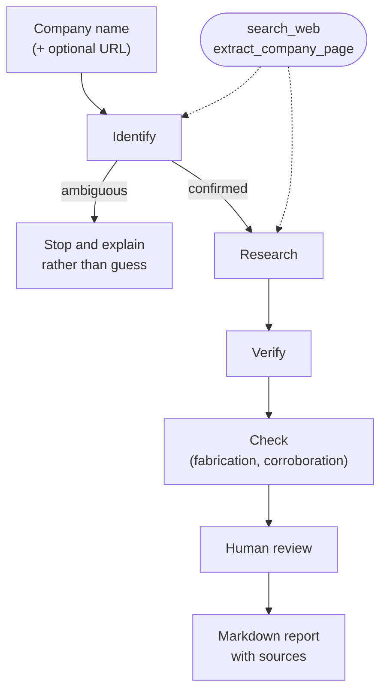

# Competitor Research Agent

An agentic AI tool that researches a startup's competitive landscape and produces a sourced Markdown report a founder can actually act on.

Give it a company name, and optionally a URL, and it identifies the company, decides for itself what to search, finds comparable competitors, independently verifies them, asks you to approve the result, and writes a report that cites where every claim came from.

**🔗 Live app: [competitor-research-agent.onrender.com](https://competitor-research-agent.onrender.com)** (Docker) · [also on Streamlit Cloud](https://competitor-research-agent-application.streamlit.app/)

*Both are free tiers and sleep when idle. The first request after a quiet spell takes 30–60 seconds to wake.*


---

## Why this exists

You could ask a chatbot "who are Acme's competitors?" and get an answer in seconds. That answer has three problems:

1. **It may be invented.** Ask about a small company and a language model will often produce a confident, well-formatted profile of a company it knows nothing about.
2. **You can't check it.** No sources, no way to tell which parts are solid and which are guesses.
3. **It isn't reproducible.** Ask twice, get two different answers, with no record of what was considered or rejected.

This tool is built around the assumption that **the model will sometimes be wrong**, and that the job of the surrounding system is to catch it, show its work, and stop rather than guess. What it sells is not intelligence, it's **traceability**.

---

## What it does



| Step | What happens | What it protects against |
|---|---|---|
| **Identify** | Confirms which company is meant. A URL, if given, outranks search results. | Researching a different company that shares the name |
| **Research** | The agent chooses its own search queries, iterating until it has enough. | Stale training data; one fixed query missing the point |
| **Verify** | A **separate** call re-checks each competitor: is it a real, named company, and is it comparable in scale? | Generic placeholders; competitors 50× the target's size |
| **Check** | Deterministic checks: every cited URL must have actually been fetched; no competitor may be a generic category. | Fabricated or altered citations |
| **Review** | You see every competitor, every rejection, and every flagged problem, and can remove any. | Everything the automated checks missed |
| **Report** | Markdown with per-competitor sources, exclusions, and stated limitations. | Unverifiable claims presented as fact |

---

## Setup

Requires Python 3.11+. Both API keys have free tiers and need no credit card.

```bash
git clone https://github.com/sravya520/competitor-research-agent.git
cd competitor-research-agent

python -m venv venv
venv\Scripts\activate        # Windows
source venv/bin/activate     # macOS / Linux

pip install -r requirements.txt
```

Create a `.env` file in the project root:

```
GEMINI_API_KEY=your-key-here
TAVILY_API_KEY=your-key-here
```

- **Gemini API key**: [Google AI Studio](https://aistudio.google.com) (free tier, no card)
- **Tavily API key**: [tavily.com](https://tavily.com) (1,000 searches/month free, no card)

> A Gemini *app* subscription is not the same thing as an API key. The key comes from AI Studio.

---

## Usage

```bash
python main.py
```

```
Enter a company or startup name: Sprout Design
Company website or LinkedIn URL (optional, press Enter to skip): https://sproutdesign.framer.website/

[extract] https://sproutdesign.framer.website/

Confirmed: Sprout Design is a boutique design studio founded by two IIT alumni,
combining product design, website design, and design strategy for startups.

[search] boutique product design studio MVP agency startup website design

================================================================
REVIEW
================================================================

Automatically excluded by verification:
  - 500 Designs: significantly larger and more established (part of the 500 Global
    ecosystem, executing enterprise projects), representing a scale mismatch.

4 competitor(s) passed verification:

  [0] UX Cabin: Flexible, senior-level boutique design partner for lean startup teams.
  [1] Semiflat Studio: Production-ready interface design specialists.
  [2] Orbix Studio: Rapid concept-to-launch execution.
  [3] Valtorian: Zero-handoff, direct-with-founders boutique studio.

Enter the numbers of any you want REMOVED (comma-separated), or press Enter to keep all:

Report written to report-sprout-design.md
4 competitor(s) included, 1 excluded.
```

Passing a URL is optional but strongly recommended for small or common-named companies. Without one, the tool will refuse to proceed if it can't tell which company you mean (see below).

A full generated report is committed as [`example-report.md`](example-report.md).

### Web UI

```bash
streamlit run app.py
```

Same pipeline, browser-based: a form for the company and URL, live progress while it searches, checkboxes to remove competitors during review, and a download button for the finished report. `app.py` is the only file that imports Streamlit. The pipeline itself (`pipeline.py`, `evaluate.py`, `report.py`, `tools.py`) has no idea a UI exists, which is what lets both entry points share it.

**Live:** [Docker on Render](https://competitor-research-agent.onrender.com) · [Streamlit Cloud](https://competitor-research-agent-application.streamlit.app/)

---

## Deployment

Deployed two ways, which is deliberate: the same application, packaged for a platform-specific host and for any container host.

### Docker (Render)

```bash
docker build -t competitor-research-agent .
docker run -p 8501:8501 --env-file .env competitor-research-agent
```

On Render: **New → Web Service**, connect this repo, runtime auto-detects as Docker, add both API keys as environment variables. Three details in the `Dockerfile` matter more than they look:

- **`--server.address=0.0.0.0`**: Streamlit binds `localhost` by default, which inside a container means *reachable only from within that container*. The app would start, report itself healthy, and refuse every external connection.
- **`${PORT:-8501}`**: container hosts assign a port and expect the app to honour it. Render assigned 10000 on the first deploy; a hardcoded 8501 would have failed its health check.
- **`exec` in the `CMD`**: makes Streamlit PID 1 so it receives stop signals directly, instead of a shell absorbing them and Streamlit being force-killed on every restart.

`.dockerignore` is not optional here. Docker does not read `.gitignore`, so a plain `COPY . .` bakes `.env`, real API keys, permanently into the image, readable by anyone who obtains it. Keys are injected at runtime instead (`--env-file` locally, dashboard variables on Render).

### Streamlit Community Cloud

At [share.streamlit.io](https://share.streamlit.io), sign in with GitHub → **New app** → this repo, branch `main`, main file `app.py`. Under **Advanced settings → Secrets**:

```toml
GEMINI_API_KEY = "your-key-here"
TAVILY_API_KEY = "your-key-here"
```

### Why the same code runs in three places

Locally keys come from `.env`; on Streamlit Cloud from `st.secrets`; in a container from real environment variables. `app.py` bridges `st.secrets` into environment variables *before* importing the pipeline, so `config.py` (and the CLI, which has never heard of Streamlit) only ever reads `os.environ`. One code path, three sources.

---

## Design decisions

Every safeguard here exists because of a specific observed failure, not because it sounded good in theory.

**Identity is confirmed before research begins.**
Asked about a two-person studio called "Sprout Design," the system repeatedly produced polished reports about *a different company with the same name*. A UK firm, an unrelated branding studio. Names are ambiguous; a URL is not. When a URL is provided, its page content is treated as authoritative and outranks anything search returns.

**When identity is ambiguous, it stops.**
An earlier version asked the user "is this the company you meant?" and continued on a yes. That was unsafe: confirming a description that said *"no entity could be verified"* let the research step latch onto the wrong company and spend its whole budget there. Now, low confidence is a hard stop with an explanation. **Refusing to answer is a feature.**

**Verification is a separate call with no shared history.**
A model asked to re-check its own reasoning tends to agree with itself. The verifier sees the proposed competitors and the target company, but not the reasoning that produced them.

**The verifier knows the target's scale.**
An early version passed only the company *name* to the verifier, then asked "is this comparable in scale?", a question it had no way to answer. Eighty-person agencies sailed through as peers of a two-person studio. The fix: independence means withholding the *reasoning*, never the *subject*.

**Verdicts pair by index, not by name.**
Matching verdicts to competitors by string equality on model-generated names broke whenever the model abbreviated one ("Parallel" vs. "Parallel Design Studios"), producing a report that dropped a competitor and then included it anyway. Competitors are numbered; verdicts echo the number.

**Sources are tracked in code, not by the model.**
The model attributes sources per competitor, which is useful but fallible. Separately, the tools record every URL actually fetched. The report contains both: best-effort attribution, and a list that can't be misremembered.

**Fabricated citations are detected automatically, then removed.**
Because the tools record every URL genuinely fetched, any URL the model cites that isn't in that record was invented. This check found a real case: the model was handed `.../best-mvp-agencies-for-early-stage-products` and cited `.../best-mvp-**design**-agencies-for-early-stage-products`: a plausible-looking link that would 404. No human reading the report would have caught it, sitting as it was among five genuine URLs. Detection alone isn't enough, so fabricated citations are stripped before the report is written: a broken link still looks like evidence.

**Every competitor is labelled by how corroborated it is, not just whether it has a source.**
A competitor with one citation and a competitor checked against several independent pages looked identical in earlier versions of the report. Both just had a "Sources" list. Now each one is counted by DISTINCT DOMAIN (two pages on the same site aren't independent confirmation of anything) and labelled plainly: corroborated across N sources, single-source and unconfirmed, or none cited at all. Nothing gets rejected for being single-sourced. A small real company legitimately may only have its own website, but nothing is presented with more confidence than the evidence actually supports either.

**Retries are selective.**
429, 5xx, and raw connection drops (`httpx.TransportError`) are retried, with exponential backoff. A 404 from a retired model name is never retried. It will fail identically forever, so retrying it just wastes quota. Retries cover the tool calls themselves (`search_web`, `extract_company_page`), not just the top-level model calls. A gap found by a live `RemoteProtocolError` during evaluation, in a tool call that had no retry protection at all.

**Listicle content is labelled at the source, and the research step can verify past it.**
"Best agencies for X" content isn't concentrated on a few spam domains. The same domain (a real competitor's own blog) can host both their legitimate site and a self-ranking roundup. So instead of blocking domains, `search_web` tags each result whose URL path matches roundup patterns (`/blog/best-`, `-alternatives`, `-vs-`, `/resources/`), and the research step was given a second tool, `extract_company_page`, previously only used for identity, with instructions to fetch a promising candidate's own site once a listicle names them, rather than trust the listicle's stats. A new metric, `primary_source_ratio`, tracks what fraction of citations rest on non-roundup sources.

**The report publishes what it rejected.**
Most tools show only what they kept. This one lists every rejected candidate with the reason, automated *and* human, so a reader can audit the judgment, not just the conclusion.

---

## Testing a non-deterministic system

```bash
python run_eval.py              # every case
python run_eval.py Duolingo     # one case
```

Regression cases live in `eval_cases.py`, and each one exists because the system once got it wrong: early runs returned global design giants as peers of a two-person studio, then CAD-drafting firms, then generic categories. Rather than defining the single "correct" competitor list for a company (which reasonable analysts would disagree about), each case asserts something narrower and checkable: *it must stop here*, or *it must not return these*.

The cases split into two tiers, and the distinction matters:

- **Gates**: stable assertions that should never break. No fabricated URLs, no generic categories, a well-known company returns real competitors.
- **Observations**: behaviour that genuinely varies between runs, reported but never failing the suite.

That split exists because this system does live web searches. The same input can legitimately produce different results on different days. One run finds no single match for an ambiguous name and stops, another finds a registered entity and proceeds. Asserting on that would be testing what search indexed this morning, not testing this code. **A test that flakes for unrelated reasons teaches you to ignore it**, and then you ignore it when it catches something real.

Each run also reports three metrics, so a change can be judged by a number instead of a guess: `primary_source_ratio` (share of citations that aren't roundup/listicle content), `corroboration_rate` (share of competitors backed by 2+ independent source domains), and a count of precise-claim warnings (oddly specific stats resting on a single source).

## Retrieval is pluggable, and two of the backends are benchmarked

Retrieval sits behind a provider protocol (`retrieval.py`), so the fetcher is a
swappable part rather than something welded into the tools. Tavily is the
default and the deployed behaviour is unchanged; `RETRIEVAL_PROVIDER` selects
`tavily`, `parallel`, `firecrawl`, `firecrawl_scrape` or `hybrid`. Nothing picks
a backend implicitly: an unset value is `tavily`, an unrecognised value warns and
falls back to `tavily`, and a missing credential fails rather than switching
backend behind your back.

`parallel` is [Parallel Search MCP](https://docs.parallel.ai/integrations/mcp/search-mcp),
reached over the official MCP client's Streamable HTTP transport at
`https://search.parallel.ai/mcp`. It is the one backend that needs no account and
no API key, which makes it the cheapest way to try the tool, so it has to be asked
for by name (`RETRIEVAL_PROVIDER=parallel`) rather than appearing on its own when
another key is absent. Search excerpts and full-page fetches feed the existing tool
callbacks and source ledger unchanged, calls carry a 45-second deadline, and a
service error propagates instead of retrying against a different provider. A Gemini
key is still required to run the agent.

Adding a second backend is only interesting if you can say which one is better,
so there is a benchmark rather than an opinion. The numbers below compare Tavily
and Firecrawl; Parallel is not in them. It runs at two levels: a
deterministic retrieval comparison with no LLM in the loop, and a full
end-to-end comparison where the backend is the only variable.

**Headline, from 20 pages fetched twice by each backend with no LLM involved:**

| backend | success | latency p50 | median chars | boilerplate | fact recall |
|---|---|---|---|---|---|
| Tavily (basic extract) | 100% | 250ms | 11,735 | 6% | 82% (56/68) |
| Firecrawl (`only_main_content=True`) | 100% | 1,390ms | 16,258 | 4% | **97%** (66/68) |

Firecrawl found 97% of independently verified facts against Tavily's 82%, at
about 5.6x the latency and about 5x the per-page credit cost. Facts come from an
answer key read off each official page by a plain HTTP request that used neither
vendor.

The end-to-end runs produced a more transferable result: **the number of
citations rejected by the fabrication check tracks how many sources the agent
managed to consult**, with model, prompts and temperature held constant. The
mode that consulted a median of 6 sources had 48 citations rejected; the mode
that consulted 31 had 4. Starve an agent of sources and it starts citing pages
it never retrieved, which looks like a hallucination problem but is a retrieval
problem.

Also measured, and worth knowing before you copy a config: Firecrawl's
`only_main_content=True` cut boilerplate on every page tested and on one page
removed a fact that lived in the site's navigation. Tavily's `advanced` extract
depth cost double, returned byte-identical content on 19 of 20 pages, and
returned `404 page not found` on the twentieth where `basic` succeeded.

Full numbers, the cases where Firecrawl loses, the mistakes I made in the
measurement itself, and the limitations that bound all of it:
**[docs/firecrawl_vs_tavily.md](docs/firecrawl_vs_tavily.md)**.

```bash
python -m benchmarks.retrieval_compare --experiment all   # full benchmark
python -m benchmarks.retrieval_compare --rescore          # re-score, no network
```

## Project structure

```
main.py        CLI orchestration and human review: reads as the workflow
app.py         Streamlit UI for the same pipeline: the only file that
               imports Streamlit; pipeline/evaluate/report/tools stay
               framework-agnostic so this and main.py can share them
pipeline.py    The three LLM steps: identify, research, verify
prompts.py     All prompt text, with comments on why each constraint exists
tools.py       search_web / extract_company_page, and source tracking
schemas.py     Pydantic models defining every structured output
evaluate.py    Automatic consistency checks: fabricated URLs, generic
               names, source corroboration, precise unsourced claims
eval_cases.py  Regression cases, each one a bug that actually happened
run_eval.py    Runs the cases and reports gates, observations, and metrics
report.py      Markdown generation, with corroboration labels inline
config.py      Clients, model choice, retry policy
retrieval.py   Provider selection, normalised documents, caching and metering
parallel_mcp.py
               Anonymous search and page fetch over the official MCP client
memory.py      The run ledger: a stable key per company, and one appended
               JSON line per finished run
recall.py      Where memory meets the pipeline: when a stored identity may
               replace the identify step, and when it may not
```

Prompts live in their own file deliberately: in an LLM application, most iteration happens in prompt text rather than code, so it should be easy to read and compare.

---

## Memory

Memory is **off unless you switch it on**, and it is off in the hosted demo. Set `MEMORY_PATH` to a file and the tool starts keeping a ledger of finished runs; leave it unset and nothing is read, nothing is written, and no file appears.

```bash
MEMORY_PATH=memory.jsonl python main.py
```

**What is stored.** One JSON object per finished run, appended as a single line: the company name, the URL that was typed or accepted, the canonical key, the resolved identity, the competitors that made the report with their positioning and sources, what was excluded automatically and what the reviewer removed, the automatic check results, and which model and retrieval backend produced it.

**Where.** Wherever `MEMORY_PATH` points. There is no default location, so an unconfigured checkout has no memory at all. The pattern is in `.gitignore` and in `.dockerignore`, because the file records which companies someone researched and Docker does not read `.gitignore`.

**How to delete it.** Delete the file. There is no index, no database and no cache anywhere else, so removing it forgets everything. Removing a single run means deleting its line.

**Why it is off in hosted demos.** The deployed app serves every visitor from one shared API key. A ledger there would mix strangers' research into one file, and now that reads can change what a run does, one visitor could inherit another's identity lookup. Off by default is the only answer that does not require trusting the host.

### What memory changes

Two things, both of which the user can see and overrule.

**It offers a website you used before.** Runs are filed under a domain, but someone typing a name alone can only ask about a name, so a name-only run can never find its own history by key. Instead the ledger is matched by normalised company name, and any websites that name resolved to before are offered with their dates. Nothing is chosen automatically, even when there is only one match: two unrelated companies can share a name, and which one is meant is not a judgement to make on someone's behalf. Accept one and the run continues exactly as if that URL had been typed.

**It reuses a recent identity.** Establishing which company is meant costs an LLM call and up to two searches, and for a company already researched under its own domain that answer exists. It is reused only when the key is strong, meaning it came from a domain, and only when the record is newer than `RECALL_MAX_AGE_DAYS` (30). An unparseable timestamp counts as unknown age and is refused. Pass `--fresh-identity` in the CLI, or tick **Re-establish identity** in the web UI, to force a live lookup regardless: no age limit knows that a company rebranded last week, and the person asking usually does.

Anything taken from an earlier run is disclosed with that run's date, in the terminal, in the web UI and as a line in the report. A cached claim otherwise reads exactly like one checked today, which is the opposite of what these reports are for.

### What memory does not do

**It never reaches the model.** No prompt changes, ever. A remembered website is shown to the user, not fed to the LLM as a candidate: the model tends to agree with what it is shown, and that would bias it toward repeating a past misidentification on exactly the ambiguous names the pipeline is designed to stop on. Memory either replaces the identify call with a stored, dated, disclosed identity, or it stays out of the way.

**It never changes a benchmark.** `recall.py` sits above `pipeline.py` rather than inside it, and `run_eval.py` calls `pipeline.identify_company` directly, so stored history cannot influence an eval. A test parses the imports of `pipeline.py`, `prompts.py`, `evaluate.py` and `run_eval.py` and fails if any of them ever imports `memory` or `recall`. The property is structural rather than a flag someone has to remember to set.

**It never decides who a company is.** A key derived from a name is flagged weak and is never used to skip identification. A host that belongs to a platform rather than a company (`linkedin.com`, `github.com`, `medium.com` and the rest of `DIRECTORY_HOSTS`) is refused as a key outright, since keying on one would file unrelated companies into a single bucket.

### How runs are keyed

The registered domain, lowercased, with `www.` removed: `https://www.Notion.so/product` and a bare `notion.so` are one key. Names cannot do this job, because model output drifts between calls and "Notion", "Notion Labs" and `notion.so` are one company. Where no domain is available the key falls back to `name:<slug>` and is marked weak; where the company cannot be identified at all the run is not filed, rather than filed under a bucket every unidentifiable run would share.

Automatic exclusions and the reviewer's own removals are stored separately. The report does not care who rejected a candidate, but a reviewer's choice is evidence of what this user wants and a verification rejection is not, so the two are never merged in storage.

Writes and reads are both best-effort: a ledger failure is logged and the run continues. Nothing in a report depends on memory being available.

---

## Limitations

Stated plainly here and in every generated report:

- **Source quality is improved but not solved.** Search results are still dominated by "best agencies for X" content by construction. That's what ranks for those queries. Labelling roundup content and giving the research step a way to verify candidates against their own site (see Design decisions) measurably raised the primary-source share in testing (roughly 85-90% on the reference cases, versus the earlier reports where nearly every citation traced to a listicle), but it is a mitigation, not a fix. The underlying bias in what the web publishes about small companies hasn't gone away.
- **Scale comparison is a judgment call.** Verification catches obvious mismatches but not every borderline one.
- **Coverage is not guaranteed.** The tool finds competitors that are findable; a strong competitor with no web presence will be missed.
- **Small companies remain hard.** Without a URL, a company with a common name and thin web presence may be unidentifiable. By design, the tool stops rather than guessing.

---

## Possible improvements

- A dedicated company-search API (e.g. Crunchbase-style data) instead of general web search, to attack what labelling and extraction alone can't fix
- A Streamlit interface so a non-technical founder can use it
- Caching, so re-running a company doesn't re-spend search quota

---

## Built with

Python · [Google Gemini API](https://ai.google.dev) (`google-genai`) · [Tavily](https://tavily.com) search · [Parallel Search MCP](https://docs.parallel.ai/integrations/mcp/search-mcp) · Firecrawl · Pydantic · Tenacity

No agent framework. The tool-calling loop, structured outputs, and verification step are wired directly against the API. The goal was to understand the mechanics rather than inherit them.
